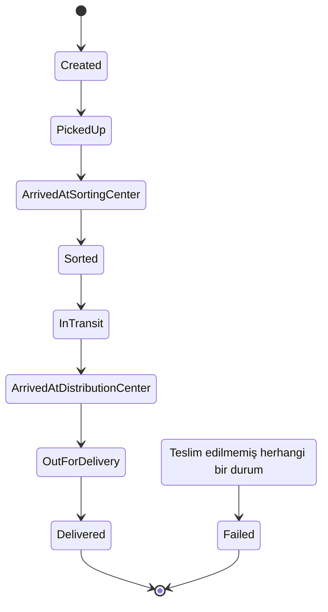
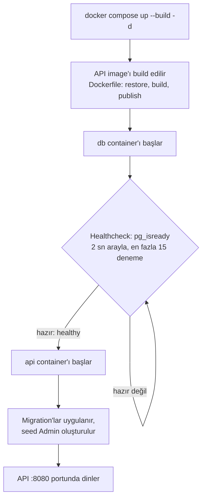
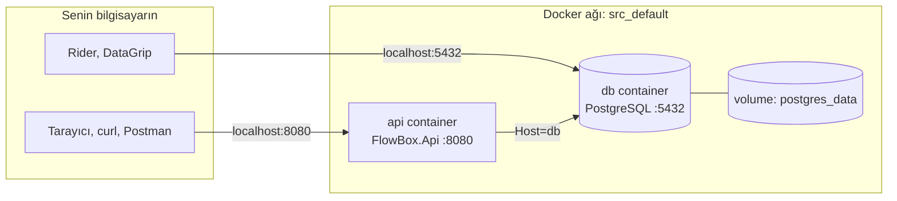

# FlowBox

Modern backend mühendisliğini, dağıtık sistemleri ve cloud-native mimariyi keşfetmek için geliştirilen ölçeklenebilir bir
lojistik ve teslimat platformu.

FlowBox klasik bir "kargo oluştur, takip et" uygulaması değil; gerçek bir kargo şirketinin backend'ini simüle ediyor:
sipariş, kargo, statü pipeline'ı, kurye atama, takip zaman çizelgesi, kimlik doğrulama ve rol/sahiplik kuralları.
Proje bir **modüler monolit** olarak başladı, ihtiyaç ortaya çıktıkça (cache, event-driven mimari, mikroservis) evrilecek.

## Teknolojiler

| Alan | Teknoloji |
|---|---|
| Dil / framework | C#, .NET 9, ASP.NET Core Minimal API |
| Veritabanı | PostgreSQL 16, EF Core 9 (Npgsql) |
| Kimlik doğrulama | JWT Bearer, rol bazlı yetkilendirme |
| Doğrulama | FluentValidation |
| API dokümantasyonu | OpenAPI + Scalar |
| Container | Docker, docker-compose |
| Test | xUnit, FluentAssertions, Testcontainers |
| CI | GitHub Actions |
| Yük testi | k6 |

## Hızlı başlangıç

Gereksinimler: Docker Desktop, .NET 9 SDK (testler için).

```bash
cd src
docker compose up --build -d
```

- API: `http://localhost:8080`
- Etkileşimli API dokümantasyonu: `http://localhost:8080/scalar/v1`
- PostgreSQL: `localhost:5432` (kullanıcı, şifre ve veritabanı adı `src/docker-compose.yml`'de)
- Yerel veriyi sıfırlamak için: `docker compose down -v`
- Docker'ın nasıl kurulduğu ve sorun giderme için [Docker](#docker) bölümüne bakın.

Uygulama açılırken migration'lar otomatik uygulanır ve ilk **Admin** hesabı `AdminSeed` ayarından oluşturulur
(geliştirme değerleri `src/FlowBox.Api/appsettings.Development.json` içinde).

## İş akışları

### 1. Kargonun yaşam döngüsü

Müşteri bir **Order** (sipariş) oluşturur, sistem bundan hemen bir **Shipment** (kargo) üretir ve takip numarasını
(`TRxxxxxx`) döner. Bundan sonraki her şey Shipment üzerinden ilerler. Her statü değişikliği, silinmeyen bir takip
kaydı (zaman çizelgesi) bırakır.



- Adımlar atlanamaz (örn. `PickedUp` → `Delivered` reddedilir; hata mesajı geçerli sonraki durumları listeler).
- `Failed`, terminal olmayan her durumdan seçilebilir. `Delivered` ve `Failed` sonrası statü değişmez.

### 2. Kim ne yapar

| Rol | Yapabildikleri |
|---|---|
| **Customer** | Kayıt olur, sipariş verir, **sadece kendi** kargolarını görür/takip eder (`/api/orders/mine`) |
| **Courier** | Kargonun statüsünü günceller (alındı, yolda, teslim edildi...) |
| **Admin** | Her şeyi görür, kurye kaydı ve kullanıcı hesabı oluşturur, kargoyu kuryeye atar |

- Herkese açık kayıt (`/api/auth/register`) her zaman **Customer** oluşturur. Courier ve Admin hesaplarını yalnızca
  bir Admin açabilir (`POST /api/admin/users`).
- Başkasının kargosunu sorgulayan Customer **404** alır, kargonun varlığı sızdırılmaz.

### 3. Uçtan uca örnek

Aşağıdaki akış çalışan bir örnektir (`curl` ve `jq` gerekir; API `localhost:8080`'de ayakta olmalı).

```bash
U=http://localhost:8080
J='Content-Type: application/json'
login() { curl -s -X POST $U/api/auth/login -H "$J" -d "{\"email\":\"$1\",\"password\":\"$2\"}" | jq -r '.token'; }

# Müşteri kaydolur, giriş yapar ve sipariş verir
curl -s -X POST $U/api/auth/register -H "$J" -d '{"email":"ayse@example.com","password":"Sifre12345!"}'
CUSTOMER_TOKEN=$(login ayse@example.com 'Sifre12345!')
TN=$(curl -s -X POST $U/api/orders -H "$J" -H "Authorization: Bearer $CUSTOMER_TOKEN" \
  -d '{"origin":"Istanbul","destination":"Konya","weight":3}' | jq -r '.trackingNumber')

# Admin (seed hesabı) kurye kaydı ve kurye kullanıcısı oluşturur, kargoyu atar
ADMIN_EMAIL=$(jq -r '.AdminSeed.Email' src/FlowBox.Api/appsettings.Development.json)
ADMIN_PASSWORD=$(jq -r '.AdminSeed.Password' src/FlowBox.Api/appsettings.Development.json)
ADMIN_TOKEN=$(login "$ADMIN_EMAIL" "$ADMIN_PASSWORD")
COURIER_ID=$(curl -s -X POST $U/api/couriers -H "$J" -H "Authorization: Bearer $ADMIN_TOKEN" \
  -d '{"name":"Ahmet Kurye","phone":"+905559876543"}' | jq -r '.id')
curl -s -X POST $U/api/admin/users -H "$J" -H "Authorization: Bearer $ADMIN_TOKEN" \
  -d '{"email":"ahmet@example.com","password":"Sifre12345!","role":"Courier"}'
curl -s -X PATCH $U/api/shipments/$TN/assign -H "$J" -H "Authorization: Bearer $ADMIN_TOKEN" \
  -d "{\"courierId\":\"$COURIER_ID\"}"

# Kurye statüyü günceller, müşteri takip eder
COURIER_TOKEN=$(login ahmet@example.com 'Sifre12345!')
curl -s -X PATCH $U/api/shipments/$TN/status -H "$J" -H "Authorization: Bearer $COURIER_TOKEN" \
  -d '{"status":"PickedUp"}'
curl -s $U/api/shipments/$TN/tracking -H "Authorization: Bearer $CUSTOMER_TOKEN" | jq
```

> Şu an "kargonun atandığı **Courier kaydı**" ile "**Courier rolündeki kullanıcı hesabı**" birbirine bağlı değil
> (yukarıda ikisi ayrı ayrı açılıyor). Bağlanması planlı işlerden biri.

### 4. Geliştirme akışı

Her özellik kendi branch'inde geliştirilir ve PR ile `main`'e girer:

1. `main`'den yeni branch aç (`feature/...`).
2. Kodu ve **hem unit hem integration testini** yaz. Şema değişirse migration ekle.
3. `dotnet test` ile iki test setini de çalıştır.
4. Commit, push, PR aç. CI (build, unit ve integration testler) yeşil olunca merge et.

Claude Code ile çalışıyorsan proje kuralları `CLAUDE.md` ve `.claude/skills/flowbox-orientation/SKILL.md`
dosyalarında tanımlıdır.

## API özeti

| Endpoint | Kim |
|---|---|
| `POST /api/auth/register`, `POST /api/auth/login` | Herkes |
| `POST /api/admin/users` | Admin |
| `POST /api/orders`, `GET /api/orders/mine` | Customer, Admin |
| `GET /api/shipments/{tn}`, `/tracking`, `/history` | Giriş yapmış kullanıcı (Customer için sahiplik kuralıyla) |
| `PATCH /api/shipments/{tn}/status` | Courier, Admin |
| `PATCH /api/shipments/{tn}/assign`, `POST /api/couriers`, `GET /api/shipments` | Admin |

Korumalı endpoint'ler `Authorization: Bearer <token>` header'ı ister.

## Mimari

```
Endpoint (sadece HTTP)  →  Service (iş kuralı)  →  Repository (arayüz)  →  EF Core / PostgreSQL
```

```
src/FlowBox.Api/
├── Endpoints/      HTTP katmanı (özellik klasörleri: Auth, Order, Shipment, Courier)
├── Service/        iş kuralları
├── Repositories/   veri erişimi arayüzleri ve EF implementasyonları
├── Data/Ef/        DbContext ve entity'ler
├── Domain/         saf iş kuralları (statü geçişleri)
├── Validators/     FluentValidation kuralları
└── Registry/       DI kayıtları ve endpoint keşfi
```

Repository'ler arayüz üzerinden kullanıldığı için iş kuralları gerçek veritabanı olmadan sahte (fake) repository'lerle
test edilebilir; bugün EF Core, ileride istenirse Dapper gibi başka bir implementasyon takılabilir.

## Docker

### Neden Docker ve docker-compose?

- **Kurulumsuz, aynı ortam:** Bilgisayarda PostgreSQL ya da .NET çalışma ortamı kurmadan, herkes aynı sürümlerle
  projeyi tek komutla çalıştırır ("bende çalışıyordu" sorunu kalmaz).
- **Tek komutla iki parça:** API ve veritabanı birlikte tanımlıdır, doğru sırayla başlar.
- **Taşınabilir:** API bir *image* olarak paketlenir; aynı image yerelde, CI'da ya da bir sunucuda çalışabilir.
- **Testlerde de kullanılır:** Integration testler Testcontainers ile geçici bir PostgreSQL container'ı ayağa kaldırır.

### Parçalar

| Parça | Dosya | Ne yapar |
|---|---|---|
| **Image tarifi** | `src/FlowBox.Api/Dockerfile` | API'yi derleyip çalıştırılabilir bir image'a paketler |
| **Build filtresi** | `src/FlowBox.Api/.dockerignore` | `bin/`, `obj/` gibi yerel derleme çıktılarını image build'ine göndermez |
| **Servis tanımları** | `src/docker-compose.yml` | `db` ve `api` container'larını, portlarını, sırasını ve volume'u tanımlar |
| `db` servisi | `postgres:16-alpine` | PostgreSQL. Hazır olup olmadığı `pg_isready` ile kontrol edilir (healthcheck) |
| `api` servisi | `FlowBox.Api` image'ı | API. `db` **sağlıklı** olana kadar başlamaz |
| Volume | `postgres_data` | Veritabanı dosyaları. Container silinse de veri kalır |
| Ağ | `src_default` (otomatik) | Container'ların birbirini isimle bulduğu özel ağ |

**Dockerfile (multi-stage):** Önce büyük olan .NET SDK image'ında proje derlenir ve yayınlanır (`restore` → `build` →
`publish`), sonra sadece yayınlanmış çıktı küçük olan ASP.NET çalışma zamanı image'ına kopyalanır. Böylece son image SDK
araçlarını taşımaz. `csproj` dosyası kaynak koddan önce kopyalanır; paket indirme katmanı sadece bağımlılıklar
değişince yeniden çalışır, her kod değişikliğinde tekrar indirilmez. `.dockerignore` sayesinde bilgisayarındaki
`bin/` ve `obj/` klasörleri build'e girmez (build context ~35 MB'tan ~0,5 MB'a iner); image her zaman kaynak koddan
temiz derlenir.

### Başlatma akışı

`docker compose up --build -d` komutu sırayla şunu yapar:



`db`'nin "sağlıklı" olmasını beklemek önemlidir: API, açılışta migration için veritabanına bağlanır. Eskiden sadece
"container başladı" kontrol edildiği için API, PostgreSQL henüz bağlantı kabul etmeden bağlanmaya çalışıp çöküyordu.
Healthcheck bu yarışı ortadan kaldırır.

### Container'lar ve adresler



| Nereden | Adres |
|---|---|
| Tarayıcı, curl, Postman | `http://localhost:8080` |
| Rider, DataGrip (veritabanı aracı) | `localhost:5432` |
| `api` container'ı → veritabanı | `db:5432` (`Host=db`) |

Container'lar birbirini **servis adıyla** bulur; bu yüzden `appsettings.Development.json` içindeki bağlantı adresi
`Host=db`'dir. `db` adı yalnızca Docker ağının içinde çözülür: bilgisayarındaki bir araç `db`'ye değil `localhost`'a
bağlanmalıdır. API'yi compose dışında (`dotnet run`) çalıştırırsan `ConnectionStrings__DefaultConnection` ortam
değişkeniyle `localhost`'u göster.

### Sık kullanılan komutlar

Komutlar `src/` klasöründe çalıştırılır.

| Komut | Ne yapar |
|---|---|
| `docker compose up --build -d` | Image'ı yeniden build eder, container'ları arka planda başlatır |
| `docker compose ps` | Container'ların durumunu gösterir (`db` için `healthy` aranır) |
| `docker compose logs api --tail 50` | API'nin son log'larını gösterir |
| `docker compose restart api` | Sadece API'yi yeniden başlatır |
| `docker compose exec db psql -U flowbox_user -d flowbox_db` | Veritabanına terminalden bağlanır |
| `docker compose down` | Container'ları durdurup siler, **veri kalır** |
| `docker compose down -v` | Container'ları ve **volume'u (tüm yerel veriyi)** siler |

### Sorun giderme

- **Kod değişikliği görünmüyor:** Eski image çalışıyordur, `--build` ile yeniden başlat.
- **API cevap vermiyor:** `docker compose logs api` ile son hatayı oku.
- **Başlangıçta migration hatası (FK ihlali vb.):** Şemaya zorunlu kolon/FK eklendiyse eski yerel veri uyumsuz kalır,
  `docker compose down -v` ile veriyi sıfırla.
- **`port is already allocated`:** 8080 ya da 5432'yi başka bir şey kullanıyor, `lsof -i :5432` ile bul.
- **Testler Docker'a ulaşamıyor:** Docker Desktop'ın açık olduğundan emin ol (integration testler için gerekli).

> `docker-compose.yml` içindeki veritabanı şifresi, `Development` ortamı ve `appsettings.Development.json` içindeki
> JWT secret / seed Admin bilgileri **yalnızca geliştirme içindir**. Gerçek bir ortamda bunlar ortam
> değişkenlerinden (`ConnectionStrings__DefaultConnection`, `Jwt__Secret`, `AdminSeed__Email`, `AdminSeed__Password`)
> gelmelidir, repoya yazılmamalıdır.

## Testler

```bash
dotnet test src/FlowBox.UnitTests/FlowBox.UnitTests.csproj          # hızlı, Docker gerekmez
dotnet test src/FlowBox.IntegrationTests/FlowBox.IntegrationTests.csproj   # Docker gerekir
```

- **Unit testler:** statü geçiş kuralları, servislerin iş mantığı (sahte repository'lerle), validator'lar.
- **Integration testler:** Testcontainers ile gerçek PostgreSQL üzerinde uçtan uca HTTP testleri; kimlik doğrulama,
  rol kuralları (401/403), müşteri sahipliği (404) ve veritabanına kalıcı yazım doğrulanır.

## Yük testi

```bash
k6 run load-tests/tracking-lookup.js
```

Takip sorgusuna (`GET /api/shipments/{tn}`) 20 → 100 → 300 eşzamanlı kullanıcıyla yük bindirir. Taban çizgisi: ~125
istek/sn, p95 ≈ 8–14 ms, %0 hata. Ayrıntılar `load-tests/README.md` içinde.

## Durum ve yol haritası

**Yapılanlar:** modüler monolit, katmanlı mimari, statü pipeline'ı ve takip zaman çizelgesi, Order/Shipment ayrımı,
JWT kimlik doğrulama, rol bazlı yetkilendirme, müşteri sahipliği, unit + integration testler, Docker, CI, yük testi.

**Sıradaki / planlananlar:**
- Kurye sahipliği: kurye sadece kendisine atanmış kargoları görsün (User ↔ Courier bağlantısı)
- Takip numarası için benzersizlik kısıtı ve index
- Event-driven mimari (Kafka), cache (Redis), arama (Elasticsearch)
- Observability (tracing, metrikler), mikroservislere ayırma
- Müşteri ve kurye mobil uygulamaları, rota optimizasyonu, gecikme tahmini
